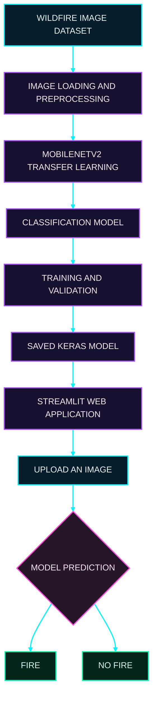

<div align="center">

# WILDFIRE DETECTION AI

### Deep Learning | Computer Vision | TensorFlow


<br>


<br><br>

**An end-to-end deep learning application for classifying wildfire-related images.**

[Project Repository](https://github.com/govardhan-goud123/Wildfire_Detection) · [Author Profile](https://github.com/govardhan-goud123)

</div>

---

## 01. Project Overview

Wildfires are a serious environmental threat that can damage forests, wildlife, property, and human communities.

This project explores how deep learning can classify images according to their visual content. It uses TensorFlow and Keras with MobileNetV2 transfer learning to distinguish between two image categories: `fire` and `nofire`.

The project combines a model-training pipeline with a Streamlit web application, allowing users to upload an image and view the model's classification.

The goal is to demonstrate a complete computer vision workflow, from dataset preparation and model training to application development and image prediction.

## 02. System Architecture

The following diagram illustrates the project's end-to-end workflow.



## 03. Core Features

| Feature                | Description                                               |
| ---------------------- | --------------------------------------------------------- |
| Image classification   | Classifies images into fire and no-fire categories        |
| Transfer learning      | Uses MobileNetV2 as the pretrained model backbone         |
| Deep learning          | Built with TensorFlow and Keras                           |
| Model training         | Provides a Python training script                         |
| Model persistence      | Saves the trained model in Keras format                   |
| Interactive interface  | Uses Streamlit for image uploads and predictions          |
| Modular implementation | Separates training, model utilities, and application code |

## 04. Technology Stack

| Technology  | Role                                     |
| ----------- | ---------------------------------------- |
| Python      | Core programming language                |
| TensorFlow  | Deep learning framework                  |
| Keras       | Neural network implementation            |
| MobileNetV2 | Pretrained image-classification backbone |
| Streamlit   | Interactive web application              |
| NumPy       | Numerical operations                     |
| Pillow      | Image handling                           |
| Git         | Version control                          |
| GitHub      | Source code hosting                      |

## 05. Project Structure

```text
Wildfire_Detection/
|
|-- wildfire_dataset/
|   |-- Training and Validation/
|   |   |-- fire/
|   |   |-- nofire/
|   |
|   |-- Testing/
|       |-- fire/
|       |-- nofire/
|
|-- models/
|   |-- wildfire_detector.keras
|
|-- model_utils.py
|-- train_model.py
|-- wildfire_detection_app.py
|-- requirements.txt
|-- .gitignore
|-- README.md
```

The trained model file is created after successful training. Its presence depends on whether the model has already been trained and saved.

## 06. Installation

### Clone the repository

```bash
git clone https://github.com/govardhan-goud123/Wildfire_Detection.git
cd Wildfire_Detection
```

### Create a virtual environment

```bash
python -m venv .venv
```

### Activate the environment

Windows PowerShell:

```powershell
.\.venv\Scripts\Activate.ps1
```

Windows Command Prompt:

```cmd
.venv\Scripts\activate.bat
```

### Install dependencies

```bash
python -m pip install --upgrade pip
pip install -r requirements.txt
```

## 07. Model Training

Train the classification model for five epochs:

```bash
python train_model.py --epochs 5
```

To change the number of epochs:

```bash
python train_model.py --epochs 10
```

The first run may require an internet connection to download the pretrained MobileNetV2 ImageNet weights.

After successful training, the model is saved to:

```text
models/wildfire_detector.keras
```

Training time and performance depend on the dataset, hardware, and training configuration.

## 08. Launch the Application

Start the Streamlit application:

```bash
streamlit run wildfire_detection_app.py
```

Open the local address displayed in the terminal.

### Prediction workflow

1. Launch the application.
2. Train the model if a trained model is not available.
3. Upload an image in JPG, JPEG, PNG, or WEBP format.
4. View the classification produced by the model.

## 09. Model Evaluation

Reliable evaluation is important for image classification, particularly when false negatives could be dangerous.

| Evaluation Metric | Purpose                                                                    |
| ----------------- | -------------------------------------------------------------------------- |
| Accuracy          | Measures the proportion of correct predictions                             |
| Precision         | Measures the proportion of predicted fire cases that are actual fire cases |
| Recall            | Measures the proportion of actual fire cases correctly classified          |
| F1-score          | Combines precision and recall                                              |
| Confusion matrix  | Shows correct and incorrect predictions by class                           |

Actual performance values should be added after evaluating the trained model on an appropriate test dataset.

No accuracy or performance score is claimed here because verified evaluation results have not been provided.

## 10. Development Roadmap

The following are potential future improvements.


Potential enhancements include:

* Detailed evaluation reports and confusion matrix visualization.
* Visual explanations of the image regions influencing predictions.
* Video-based fire classification.
* Inference performance optimization.
* Evaluation on more diverse environmental images.
* Deployment for broader accessibility.

These items are planned possibilities, not features claimed to be implemented.

## 11. Limitations and Safety

This project performs binary image classification. It does not identify the exact location of a fire or provide a verified emergency alert.

Predictions can be wrong, especially when images differ from the training data. A no-fire prediction does not establish that an area is safe.

The application must not be used as a replacement for official fire alerts, emergency services, or professional safety assessments.

## 12. Skills Demonstrated

This project demonstrates practical work with:

* Python programming
* Deep learning using TensorFlow and Keras
* Computer vision and image classification
* Transfer learning with MobileNetV2
* Dataset preparation and model training
* Streamlit application development
* Model saving and loading
* Git and GitHub workflows

## 13. Author

<div align="center">

### Govardhan Goud

AI and Data Science | Machine Learning | Deep Learning | Computer Vision

[GitHub Profile](https://github.com/govardhan-goud123)

</div>

---

<div align="center">

**WILDFIRE DETECTION AI**

TensorFlow · Keras · MobileNetV2 · Streamlit

Developed as a practical exploration of deep learning for environmental image classification.

</div>
