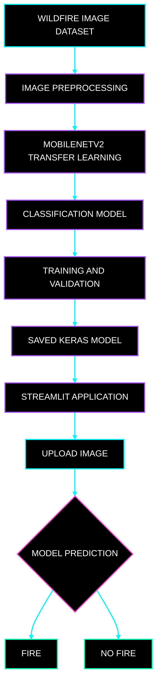
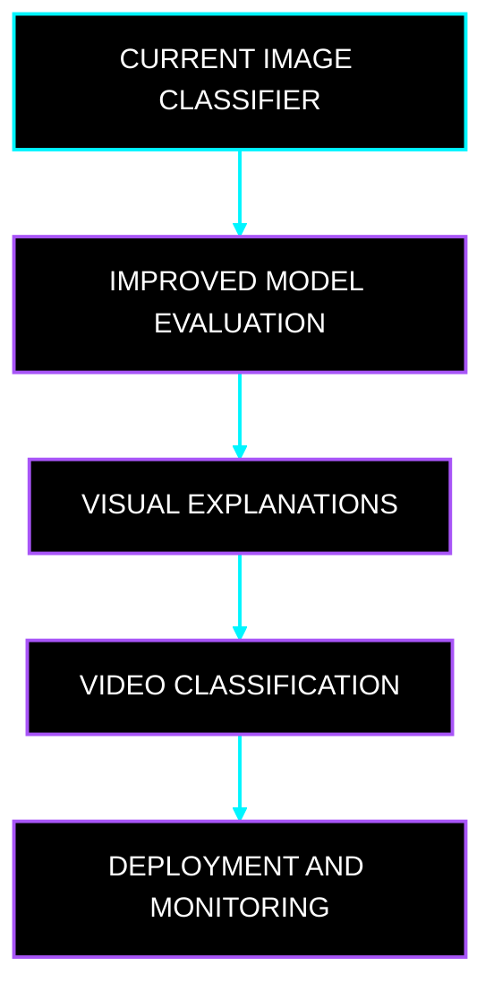

<div align="center">


<br>


<br><br>

**An intelligent image-classification system built with deep learning.**

[Explore the Repository](https://github.com/govardhan-goud123/Wildfire_Detection) | [Explore the Author Profile](https://github.com/govardhan-goud123)

</div>

---

<div align="center">


</div>

## Project Overview

Wildfires can cause significant damage to forests, wildlife, property, and human communities. Identifying fire-related images is one way to explore how artificial intelligence can support environmental monitoring.

Wildfire Detection AI is a computer vision project that uses TensorFlow, Keras, and MobileNetV2 to classify images into two categories: `fire` and `nofire`.

The project combines deep learning, image preprocessing, model training, and an interactive Streamlit application.

Users can upload an image and view the classification generated by the trained model.

The project demonstrates a complete machine learning workflow, from dataset preparation to model inference.

---

<div align="center">


</div>

## Core Capabilities

| Capability              | Description                                                |
| ----------------------- | ---------------------------------------------------------- |
| Image Classification    | Classifies images into fire and no-fire categories         |
| Transfer Learning       | Uses MobileNetV2 as a pretrained model backbone            |
| Deep Learning           | Uses TensorFlow and Keras                                  |
| Image Preprocessing     | Prepares images for model input                            |
| Model Training          | Provides a dedicated training script                       |
| Model Saving            | Saves the trained model in Keras format                    |
| Interactive Application | Uses Streamlit to provide a user interface                 |
| Modular Code            | Separates model utilities, training, and application logic |

<div align="center">


</div>

---

<div align="center">


</div>

## System Architecture

The following flowchart shows the major components of the project.



<div align="center">


</div>

---

<div align="center">


</div>

## Technology Stack

| Technology  | Application                        |
| ----------- | ---------------------------------- |
| Python      | Main programming language          |
| TensorFlow  | Deep learning framework            |
| Keras       | Model development and training     |
| MobileNetV2 | Pretrained neural network backbone |
| Streamlit   | Interactive web interface          |
| NumPy       | Numerical operations               |
| Pillow      | Image processing                   |
| Git         | Version control                    |
| GitHub      | Repository hosting                 |

<div align="center">


</div>

---

<div align="center">


</div>

## Project Structure

```text
Wildfire_Detection/
|
|-- wildfire_dataset/
|   |-- Training and Validation/
|   |   |-- fire/
|   |   |-- nofire/
|   |
|   |-- Testing/
|       |-- fire/
|       |-- nofire/
|
|-- models/
|   |-- wildfire_detector.keras
|
|-- model_utils.py
|-- train_model.py
|-- wildfire_detection_app.py
|-- requirements.txt
|-- .gitignore
|-- README.md
```

### Important Files

**`model_utils.py`**

Contains model-related utility functions used by the project.

**`train_model.py`**

Provides the model-training entry point.

**`wildfire_detection_app.py`**

Contains the Streamlit application.

**`models/wildfire_detector.keras`**

Stores the trained model after successful training.

**`requirements.txt`**

Lists the Python dependencies required by the project.

The exact dataset folder structure must match the implementation in the training code.

---

<div align="center">


</div>

## Installation Guide

### Step 1. Clone the Repository

```bash
git clone https://github.com/govardhan-goud123/Wildfire_Detection.git
cd Wildfire_Detection
```

### Step 2. Create a Virtual Environment

```bash
python -m venv .venv
```

### Step 3. Activate the Environment

Windows PowerShell:

```powershell
.\.venv\Scripts\Activate.ps1
```

Windows Command Prompt:

```cmd
.venv\Scripts\activate.bat
```

### Step 4. Install Dependencies

```bash
python -m pip install --upgrade pip
pip install -r requirements.txt
```

<div align="center">


</div>

---

<div align="center">


</div>

## Model Training

Run the training script for five epochs:

```bash
python train_model.py --epochs 5
```

To train for ten epochs:

```bash
python train_model.py --epochs 10
```

The first run may require an internet connection to download pretrained MobileNetV2 ImageNet weights.

After successful training, the model should be saved to:

```text
models/wildfire_detector.keras
```

The available command-line options depend on how the training script is implemented.

### Training Workflow


<div align="center">


</div>

---

<div align="center">


</div>

## Launch the Application

Run the Streamlit application:

```bash
streamlit run wildfire_detection_app.py
```

Open the local address displayed in your terminal.

### Prediction Workflow

1. Launch the application.
2. Ensure a trained model is available.
3. Upload an image supported by the application.
4. Wait for the prediction.
5. View the classification result.

<div align="center">


</div>

---

<div align="center">


</div>

## Model Evaluation

A classification model should be evaluated on data that was not used to train it.

| Metric           | Purpose                                                            |
| ---------------- | ------------------------------------------------------------------ |
| Accuracy         | Measures the proportion of correct predictions                     |
| Precision        | Measures how many predicted fire cases are actually fire cases     |
| Recall           | Measures how many actual fire cases the model correctly identifies |
| F1-Score         | Combines precision and recall                                      |
| Confusion Matrix | Summarizes correct and incorrect classifications                   |

For wildfire classification, recall for the fire category deserves particular attention because a false negative could mean that a fire-related image is classified as no-fire.

Actual scores should be reported only after testing the trained model.

<div align="center">


</div>

---

<div align="center">


</div>

## Future Development Roadmap

The following features are possible future improvements.



Potential improvements include:

* More comprehensive evaluation reports.
* Visual explanations of the image regions influencing predictions.
* Video-based fire classification.
* Evaluation on more diverse environmental images.
* Faster inference and model optimization.
* Deployment through a hosted web application.
* Monitoring of prediction performance.

These are proposed enhancements, not features claimed to be implemented.

<div align="center">


</div>

---

<div align="center">


</div>

## Limitations and Safety

This application classifies images. It does not independently detect a real-time wildfire, establish a fire's location, or provide a verified emergency alert.

Predictions may be incorrect when images differ from the training data.

A no-fire prediction does not prove that an area is safe. This project must not replace official fire alerts, emergency services, or professional safety assessments.

---

<div align="center">


</div>

## Skills Demonstrated

* Python programming
* Deep learning with TensorFlow and Keras
* Computer vision and image classification
* Transfer learning with MobileNetV2
* Image preprocessing
* Model training and evaluation
* Model saving and inference
* Streamlit application development
* Git and GitHub workflows

<div align="center">


</div>

---

<div align="center">


### AI and Data Science

Machine Learning | Deep Learning | Computer Vision

[GitHub Profile](https://github.com/govardhan-goud123)

<br>


</div>

---

<div align="center">

**WILDFIRE DETECTION AI**

Python | TensorFlow | Keras | MobileNetV2 | Streamlit

An applied deep learning project exploring image classification for environmental awareness.

</div>
